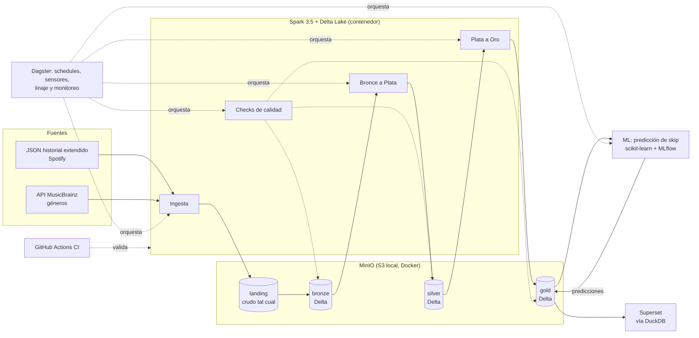

# Arquitectura y decisiones

Diseño del lakehouse. Las decisiones llevan id (`D1`, `D2`...) para citarlas en código y docs. El diagrama final
(entregable 1) vive en `ENTREGABLES/01_diagrama_arquitectura/`; este es el borrador de trabajo.

## 1. Vista general



## 2. Decisiones

| Id | Decisión | Por qué | Alternativa descartada |
|---|---|---|---|
| D1 | Todo local en Docker Compose, $0 | Lo permite el PDF; replicable con un solo comando | Nube (costo, cuentas) |
| D2 | **MinIO** como almacenamiento S3, imagen de Chainguard fijada por digest | Lo nombra la rúbrica. MinIO cerró Docker Hub (oct 2025) y quay.io (sep 2026, H-002); Chainguard es gratis, mantenida y el digest no cambia | SeaweedFS (no lo nombra la rúbrica), imagen vieja de quay (ya no baja) |
| D3 | **Un bucket por capa**: `landing`, `bronze`, `silver`, `gold` | Permite políticas de acceso por capa (mínimo privilegio) | Un bucket con prefijos |
| D4 | **Delta Lake** como formato de tabla | Rúbrica; ACID, esquema forzado, MERGE, time travel, OPTIMIZE | Iceberg (más piezas: catálogo REST) |
| D5 | **Spark (PySpark) en modo local dentro de un contenedor** | Lo vimos en clase. En contenedor se evita winutils/Hadoop de Windows | Cluster master/worker (más RAM, mismo resultado con 15k filas) |
| D6 | **Dagster** como orquestador | Assets por capa con grafo de linaje visual, asset checks (calidad por capa), schedules y sensores: evidencia directa para 3 criterios de la rúbrica | Airflow (más pesado, sin linaje de datos nativo) |
| D7 | La lógica vive en `src/lakehouse/` como funciones puras con CLI; Dagster solo las envuelve | Separa autoría (Nora orquesta, cada rol su lógica) y permite probar sin orquestador | Lógica dentro de los assets |
| D8 | **Seudonimización de `ip_addr` en Bronce** (HMAC-SHA256 con la sal `IP_HASH_SALT`), se elimina en Plata. La cuarentena también guarda el hash, no la IP | Privacidad desde la primera capa tabular; el crudo solo existe en landing (bucket restringido) | Guardar la IP en claro en Bronce |
| D9 | Géneros con **MusicBrainz**, respuestas crudas cacheadas en landing | Gratis, sin llave; la API de Spotify se cerró en 2026 (ver DATOS_FUENTE §2) | Spotify API, dataset de Kaggle |
| D10 | **Oro en modelo estrella** + marts de KPIs | BI rápido (consultas sobre tablas chicas y agregadas) y ML con features listas | Una tabla ancha |
| D11 | ML: **predicción de skip** (clasificación binaria), split temporal | Un solo usuario: no hay deserción entre usuarios; el skip tiene valor de negocio (curación de playlists) y miles de etiquetas | Recomendador (sin otros usuarios), clustering (métricas débiles) |
| D12 | ML lee Oro con Spark y entrena con scikit-learn; tracking con **MLflow** | Métricas ricas y trazables; 15k filas no necesitan MLlib | Spark MLlib |
| D13 | BI con **Apache Superset** en el compose, leyendo Oro por **DuckDB** (`delta_scan` sobre MinIO); el tablero se exporta al repo | Está en la lista del PDF, vive en el repo y se levanta solo; DuckDB responde en milisegundos sin levantar Spark | Power BI (solo Windows, no lee Delta de MinIO fácil), Spark Thrift (lento) |
| D14 | Datos sintéticos con el mismo esquema para CI y réplica | El repo es público: nadie más tiene nuestros datos | Subir una muestra real (privacidad) |
| D15 | Ingesta idempotente por hash SHA-256 de archivo + bitácora de ingesta | Re-correr no duplica; registro auditable | Sobrescribir todo cada vez |
| D16 | Registros malformados a **cuarentena** con causa, no se tiran ni rompen la corrida | Manejo de errores (rúbrica) y reconciliación de conteos | Fallar toda la corrida |
| D17 | Usuarios de MinIO por servicio con políticas mínimas: `svc-ingestion` (landing y bronze), `svc-transformation` (lee bronze; escribe silver y gold), `svc-governance` (solo lee bronze, silver y gold), `svc-ml` (lee gold; escribe solo `gold/ml_*`), `svc-bi` (solo lee gold). La matriz vive en `governance/access.py`; de ahí salen las políticas JSON y una prueba en vivo. El root no entra al contenedor del pipeline | Seguridad demostrable para Gobernanza; landing (IP en claro) solo la ve la ingesta | Usar el root en todo |
| D18 | **uv** para todo lo local (`pyproject.toml` + `uv.lock` versionados, Python 3.11); la imagen Docker instala con `uv sync --frozen` del mismo lock | Un solo manejador y versiones idénticas en local, contenedor y CI | pip/requirements por separado |
| D19 | **Código en la raíz**; `ENTREGABLES/` solo con lo que se entrega y no es código, numerado como el PDF | El revisor encuentra cada entregable sin buscar; el código queda como un proyecto Python normal | Todo dentro de `ENTREGABLES/` |
| D20 | Ingesta: archivos de landing con **boto3**; cada registro se **valida en Python contra el contrato** y luego se escribe a Delta con Spark. Idempotencia con `replaceWhere` sobre el SHA-256 del archivo | Cuarentena por registro con causa exacta (`bad_type:ms_played`); el lector JSON de Spark con `multiLine` marca corrupto el archivo entero. `replaceWhere` hace que re-correr (aun tras una caída a la mitad) no duplique. 15k filas caben de sobra en el driver | Lector JSON de Spark en modo PERMISSIVE; `append` simple |
| D21 | **Plata se recalcula completa** (overwrite) en cada corrida; **`fact_plays` se actualiza con MERGE** por `play_id` (inserta, actualiza si cambió, borra lo que salió de Plata) y OPTIMIZE + Z-ORDER por `date_key` solo si el MERGE cambió algo; dimensiones y marts se reescriben | Dedup y sesiones dependen de filas vecinas (15k filas: segundos); el MERGE demuestra la carga incremental y re-correr escribe 0 filas | Plata incremental (sesiones rotas en los bordes), reescribir Oro completo |
| D22 | Las tablas de Plata y Oro se **crean desde su contrato** (tipos, NOT NULL, comentario por columna) y se escriben con `mergeSchema` | Delta rechaza nulls en columnas obligatorias y deja agregar columnas, pero no cambiar tipos: evolución de esquema controlada | Esquema inferido del DataFrame |
| D23 | **El contrato es la fuente de la gobernanza**: privacidad por columna, clasificación, dueño, `sources`, llaves, referencias, valores, rangos y reglas SQL. De él salen el catálogo, el linaje, los checks de calidad (error bloquea, aviso no) y las propiedades y comentarios de cada tabla Delta, que se sincronizan al escribir | Una sola definición: imposible que el catálogo y los checks digan cosas distintas | Great Expectations (otra definición aparte, más piezas), checks escritos a mano por tabla |
| D24 | **Dagster corre cada paso como un subproceso de su CLI** con el usuario de su rol. Hay un asset por tabla (el grafo sale de los `sources` del contrato). Los checks bloqueantes van **por paso**: corren `governance check --tables` de lo que el paso escribió. Sensores de carpeta de origen y de landing, schedule diario (6:00 CDMX) y de salud (cada 6 h), y alerta de falla en logs. Bronce se compacta (OPTIMIZE) al final de cada ingesta con archivos nuevos | Una SparkSession no cambia de credenciales (D17), así que cada paso es su propio proceso; los roles no se importan entre sí; los checks por capa formaban un ciclo, porque géneros escribe en Bronce después de que Bronce ya pasó sus checks (H-008); cada archivo de landing deja archivos chicos (H-009) | Ops que importan la lógica de cada rol; checks por capa; un solo usuario para Dagster |

## 2.1 Estructura del repo

```text
/                         README (cómo replicar), CLAUDE.md, pyproject.toml, uv.lock, .python-version,
                          .env.example, docker-compose.yml
src/lakehouse/
  common/                 config, SparkSession, logs, errores, smoke       (Gabriel)
  ingestion/              landing, Bronce, MusicBrainz, sintéticos          (Ricardo)
  transformation/         Plata y Oro                                       (Juan Pablo)
  governance/             contratos, calidad, catálogo, linaje, seudónimos  (Victor)
  ml/                     features, entrenamiento, inferencia               (Fernando)
  orchestration/          Dagster: assets, checks, schedules, sensores, monitoreo (Nora)
infra/                    app/ (Dockerfile), minio/ (buckets y políticas), superset/
bi/                       vistas SQL sobre Oro y export del tablero         (Emilio)
notebooks/                presentación del modelo                           (Fernando)
tests/                    espejo de src/lakehouse/
.github/                  workflows/ (Nora), CODEOWNERS (Gabriel)
ENTREGABLES/              01_diagrama_arquitectura/ 02_infraestructura/ 03_calidad_y_linaje/
                          04_modelo_ml/ 05_tablero_bi/ 06_video/ y README.md (índice contra la rúbrica)
DOCS/  MDS_DE_ESTUDIO/    docs de trabajo y guías por integrante
```

## 3. Tablas por capa

Esquemas exactos (tipos, nulos, descripción): `src/lakehouse/governance/contracts.py`, la única definición.

| Capa | Tabla | Grano | Notas |
|---|---|---|---|
| landing | `spotify/<fecha>/<archivo>.json` (metadato `sha256`), `musicbrainz/<api\|synthetic>/<hash del nombre>.json` | archivo | Crudo intacto |
| bronze | `spotify_streams` | reproducción | Campos fuente (`ts` ya como timestamp UTC) + `ip_addr_hash` + `_source_file`, `_file_sha256`, `_record_index`, `_batch_id`, `_ingested_at` |
| bronze | `musicbrainz_artists` | artista consultado | `status`, `mbid`, `match_score`, `genres` (nombre y votos) + documento crudo |
| bronze | `_ingestion_log`, `_quarantine` | archivo / registro | Auditoría y errores con causa |
| silver | `plays` | reproducción de música | Sin duplicados ni IP; inicio y fin, hora local, familia de plataforma, sesión, `is_skip`, linaje a Bronce |
| silver | `episodes` | reproducción de podcast | Mismo contexto que `plays` |
| silver | `_discarded` | fila de Bronce descartada | Causa (`duplicate`, `no_content`, `audiobook_not_supported`); cuadra la reconciliación |
| silver | `artists` | artista | Géneros por votos y principal; `null` si no hubo match o no tiene géneros |
| gold | `dim_track`, `dim_artist`, `dim_date`, `dim_platform` | dimensión | `dim_date` continua; `dim_platform` es catálogo fijo |
| gold | `fact_plays` | reproducción | MERGE por `play_id`, particionada por año, OPTIMIZE + Z-ORDER por `date_key` (D21) |
| gold | `kpi_listening_daily`, `kpi_top_artists_monthly`, `kpi_genres_monthly`, `kpi_artist_retention` | agregado | Lo que consume el tablero |
| gold | `ml_skip_features`, `ml_skip_predictions` | reproducción | Entrada y salida del modelo (F6) |

## 4. Servicios del compose

| Servicio | Imagen | Puerto | Dueño |
|---|---|---|---|
| `minio` | `cgr.dev/chainguard/minio` (digest fijado) | 9000 API, 9001 consola | Gabriel |
| `minio-init` | `cgr.dev/chainguard/minio-client:latest-dev` (digest fijado) | | Gabriel (buckets), Victor (usuarios y políticas) |
| `lakehouse` | propia (`infra/app/Dockerfile`): Python 3.11 + Java 17 + PySpark + delta-spark + Dagster (`dagster dev`) | 3300 Dagster (`DAGSTER_PORT`; adentro 3000, H-007), 4040 Spark UI | Gabriel (imagen), Nora (Dagster) |
| `mlflow` | `ghcr.io/mlflow/mlflow:v3.18.0` (digest fijado), SQLite + artefactos en volumen | 5000 | Nora |
| `superset` | propia: `apache/superset` + `duckdb-engine` | 8088 | Emilio |
