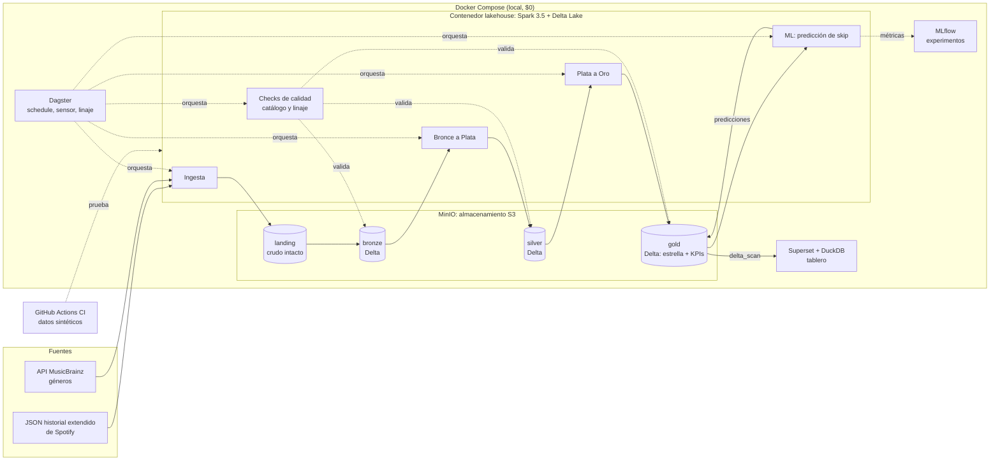

# Diagrama de arquitectura

Entregable 1. Versión 1 (F1); la final con imagen exportada queda en F8. GitHub dibuja el Mermaid directo.

| Pieza | Qué hace | Dónde está |
|---|---|---|
| MinIO | Almacenamiento S3 local, un bucket por capa | `docker-compose.yml` (servicio `minio`), `infra/minio/` |
| Spark + Delta Lake | Cómputo y formato de tabla con ACID, historial y time travel | `infra/app/Dockerfile`, `src/lakehouse/common/spark.py` |
| Medallion | landing > bronze > silver > gold | `src/lakehouse/ingestion/`, `src/lakehouse/transformation/` |
| Gobernanza | Contratos, calidad, catálogo, linaje, seudonimización | `src/lakehouse/governance/` |
| Dagster | Orquestación sin ejecuciones manuales | `src/lakehouse/orchestration/` |
| ML | Predicción de skip leyendo de Oro, MLflow | `src/lakehouse/ml/`, `notebooks/` |
| BI | Superset sobre Oro vía DuckDB | `bi/`, `infra/superset/` |

Decisiones y su porqué: [DOCS/ARQUITECTURA.md](../../DOCS/ARQUITECTURA.md).
