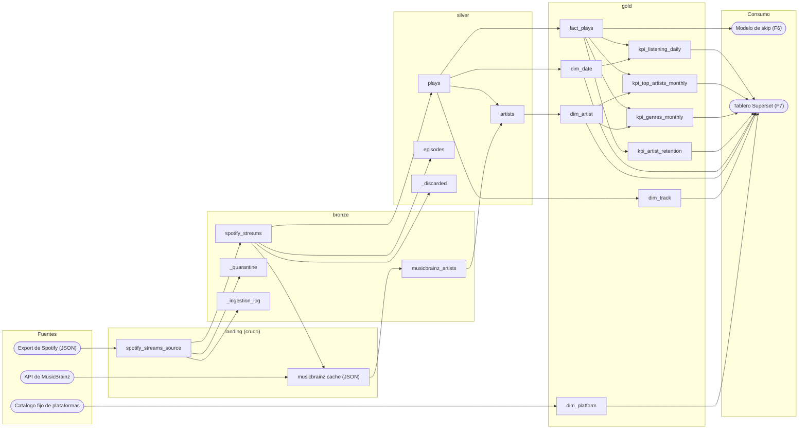

# Calidad y linaje

> Generado por `python -m lakehouse.governance check` el 2026-11-23 19:40 UTC sobre las tablas de MinIO.
> No se edita a mano. Solo conteos: ningún valor de los datos.
> Catálogo: [CATALOGO.md](CATALOGO.md). Linaje de columnas: [LINAJE.md](LINAJE.md).

**Resultado:** todo en verde; 0 avisos. ✅ pasa, ❌ falla (bloquea), ⚠️ aviso (no bloquea).

## Resumen por capa

| Capa | Tablas | Filas | Checks | OK | Fallas | Avisos |
|---|---|---|---|---|---|---|
| Bronce | 4 | 17,046 | 67 | 67 | 0 | 0 |
| Plata | 4 | 17,044 | 82 | 82 | 0 | 0 |
| Oro | 9 | 37,833 | 167 | 167 | 0 | 0 |

## Reconciliación y frescura entre capas

| | Check | Detalle |
|---|---|---|
| ✅ | bitacora = bronce | sum(rows_loaded) = spotify_streams: 15743 vs 15743 |
| ✅ | bitacora = cuarentena | sum(rows_quarantined) = _quarantine: 0 vs 0 |
| ✅ | bronce = plata + descartes | spotify_streams = plays + episodes + _discarded: 15743 vs 15743 |
| ✅ | artistas de plata = artistas escuchados | artists = artist_name distintos en plays: 1301 vs 1301 |
| ✅ | plata = oro | plays = fact_plays: 15628 vs 15628 |
| ✅ | dim_track = canciones de plata | dim_track = track_uri distintos en plays: 3628 vs 3628 |
| ✅ | kpi diario = fact con fecha | fact_plays con date_key = suma de plays diarios: 15618 vs 15618 |
| ✅ | ingesta reciente | hace 0 dias (umbral 30) |
| ✅ | plata al dia con bronce |  |
| ✅ | oro al dia con plata |  |

## Seguridad: usuarios de MinIO (D17)

Cada servicio entra con su propio usuario y una política de mínimo privilegio
(`infra/minio/policies/`, generadas desde `src/lakehouse/governance/access.py`).

| Usuario | Para qué | landing | bronze | silver | gold |
|---|---|---|---|---|---|
| `svc-ingestion` | Sube los JSON a landing y escribe Bronce | lee y escribe | lee y escribe | sin acceso | sin acceso |
| `svc-transformation` | Lee Bronce y escribe Plata y Oro | sin acceso | lee | lee y escribe | lee y escribe |
| `svc-governance` | Lee Bronce, Plata y Oro para los checks de calidad | sin acceso | lee | lee | lee |
| `svc-ml` | Lee Oro y escribe solo sus tablas ml_* (F6) | sin acceso | sin acceso | sin acceso | lee; escribe `ml_*` |
| `svc-bi` | Superset: solo lectura de Oro (F7) | sin acceso | sin acceso | sin acceso | lee |

- Llaves root de MinIO dentro del contenedor del pipeline: no ✅
- `ip_addr`: HMAC-SHA256 con sal en Bronce y eliminada en Plata (check de privacidad por tabla).

Prueba en vivo con cada usuario: **41 de 41** operaciones dieron lo esperado (permitido o negado).

| Usuario | Bucket | Operación | Esperado | Real | |
|---|---|---|---|---|---|
| `svc-ingestion` | landing | listar | permitido | permitido | ✅ |
| `svc-ingestion` | landing | escribir | permitido | permitido | ✅ |
| `svc-ingestion` | bronze | listar | permitido | permitido | ✅ |
| `svc-ingestion` | bronze | escribir | permitido | permitido | ✅ |
| `svc-ingestion` | silver | listar | negado | negado | ✅ |
| `svc-ingestion` | silver | escribir | negado | negado | ✅ |
| `svc-ingestion` | gold | listar | negado | negado | ✅ |
| `svc-ingestion` | gold | escribir | negado | negado | ✅ |
| `svc-transformation` | landing | listar | negado | negado | ✅ |
| `svc-transformation` | landing | escribir | negado | negado | ✅ |
| `svc-transformation` | bronze | listar | permitido | permitido | ✅ |
| `svc-transformation` | bronze | escribir | negado | negado | ✅ |
| `svc-transformation` | silver | listar | permitido | permitido | ✅ |
| `svc-transformation` | silver | escribir | permitido | permitido | ✅ |
| `svc-transformation` | gold | listar | permitido | permitido | ✅ |
| `svc-transformation` | gold | escribir | permitido | permitido | ✅ |
| `svc-governance` | landing | listar | negado | negado | ✅ |
| `svc-governance` | landing | escribir | negado | negado | ✅ |
| `svc-governance` | bronze | listar | permitido | permitido | ✅ |
| `svc-governance` | bronze | escribir | negado | negado | ✅ |
| `svc-governance` | silver | listar | permitido | permitido | ✅ |
| `svc-governance` | silver | escribir | negado | negado | ✅ |
| `svc-governance` | gold | listar | permitido | permitido | ✅ |
| `svc-governance` | gold | escribir | negado | negado | ✅ |
| `svc-ml` | landing | listar | negado | negado | ✅ |
| `svc-ml` | landing | escribir | negado | negado | ✅ |
| `svc-ml` | bronze | listar | negado | negado | ✅ |
| `svc-ml` | bronze | escribir | negado | negado | ✅ |
| `svc-ml` | silver | listar | negado | negado | ✅ |
| `svc-ml` | silver | escribir | negado | negado | ✅ |
| `svc-ml` | gold | listar | permitido | permitido | ✅ |
| `svc-ml` | gold | escribir | negado | negado | ✅ |
| `svc-ml` | gold | escribir ml_* | permitido | permitido | ✅ |
| `svc-bi` | landing | listar | negado | negado | ✅ |
| `svc-bi` | landing | escribir | negado | negado | ✅ |
| `svc-bi` | bronze | listar | negado | negado | ✅ |
| `svc-bi` | bronze | escribir | negado | negado | ✅ |
| `svc-bi` | silver | listar | negado | negado | ✅ |
| `svc-bi` | silver | escribir | negado | negado | ✅ |
| `svc-bi` | gold | listar | permitido | permitido | ✅ |
| `svc-bi` | gold | escribir | negado | negado | ✅ |

## Linaje tabla a tabla

## Resultados por tabla

### `bronze.spotify_streams` (15,743 filas; 20 de 20 OK)

| | Tipo | Check | Detalle |
|---|---|---|---|
| ✅ | existe | la tabla existe |  |
| ✅ | esquema | columnas y tipos del contrato |  |
| ✅ | esquema | sin columnas fuera del contrato |  |
| ✅ | privacidad | sin IP ni seudonimo donde no toca |  |
| ✅ | metadatos | comentarios y propiedades del contrato |  |
| ✅ | volumen | tiene filas |  |
| ✅ | no_nulos | ts no nulo |  |
| ✅ | no_nulos | ms_played no nulo |  |
| ✅ | rango | ms_played en [0, inf] |  |
| ✅ | no_nulos | _source_file no nulo |  |
| ✅ | no_nulos | _file_sha256 no nulo |  |
| ✅ | no_nulos | _record_index no nulo |  |
| ✅ | rango | _record_index en [0, inf] |  |
| ✅ | no_nulos | _batch_id no nulo |  |
| ✅ | no_nulos | _ingested_at no nulo |  |
| ✅ | regla | ts no anterior a Spotify |  |
| ✅ | regla | ts no en el futuro |  |
| ✅ | regla | ip_addr_hash es HMAC-SHA256 (no una IP) |  |
| ✅ | regla | _file_sha256 es un SHA-256 |  |
| ✅ | unicos | unica por (_file_sha256, _record_index) |  |

### `bronze._quarantine` (0 filas; 14 de 14 OK)

| | Tipo | Check | Detalle |
|---|---|---|---|
| ✅ | existe | la tabla existe |  |
| ✅ | esquema | columnas y tipos del contrato |  |
| ✅ | esquema | sin columnas fuera del contrato |  |
| ✅ | privacidad | sin IP ni seudonimo donde no toca |  |
| ✅ | metadatos | comentarios y propiedades del contrato |  |
| ✅ | volumen | tiene filas | tabla vacia |
| ✅ | no_nulos | _source_file no nulo |  |
| ✅ | no_nulos | _file_sha256 no nulo |  |
| ✅ | rango | _record_index en [0, inf] |  |
| ✅ | no_nulos | cause no nulo |  |
| ✅ | no_nulos | _batch_id no nulo |  |
| ✅ | no_nulos | _ingested_at no nulo |  |
| ✅ | regla | raw_record sin ip_addr en claro |  |
| ✅ | regla | _file_sha256 es un SHA-256 |  |

### `bronze._ingestion_log` (2 filas; 18 de 18 OK)

| | Tipo | Check | Detalle |
|---|---|---|---|
| ✅ | existe | la tabla existe |  |
| ✅ | esquema | columnas y tipos del contrato |  |
| ✅ | esquema | sin columnas fuera del contrato |  |
| ✅ | privacidad | sin IP ni seudonimo donde no toca |  |
| ✅ | metadatos | comentarios y propiedades del contrato |  |
| ✅ | volumen | tiene filas |  |
| ✅ | no_nulos | file_sha256 no nulo |  |
| ✅ | no_nulos | source_file no nulo |  |
| ✅ | no_nulos | batch_id no nulo |  |
| ✅ | no_nulos | rows_read no nulo |  |
| ✅ | rango | rows_read en [0, inf] |  |
| ✅ | no_nulos | rows_loaded no nulo |  |
| ✅ | rango | rows_loaded en [0, inf] |  |
| ✅ | no_nulos | rows_quarantined no nulo |  |
| ✅ | rango | rows_quarantined en [0, inf] |  |
| ✅ | no_nulos | ingested_at no nulo |  |
| ✅ | regla | leidas = cargadas + cuarentena |  |
| ✅ | frescura | ingesta reciente | hace 0 dias (umbral 30) |

### `bronze.musicbrainz_artists` (1,301 filas; 15 de 15 OK)

| | Tipo | Check | Detalle |
|---|---|---|---|
| ✅ | existe | la tabla existe |  |
| ✅ | esquema | columnas y tipos del contrato |  |
| ✅ | esquema | sin columnas fuera del contrato |  |
| ✅ | privacidad | sin IP ni seudonimo donde no toca |  |
| ✅ | metadatos | comentarios y propiedades del contrato |  |
| ✅ | volumen | tiene filas |  |
| ✅ | no_nulos | artist_name no nulo |  |
| ✅ | no_nulos | status no nulo |  |
| ✅ | valores | status en {matched, no_match} |  |
| ✅ | rango | match_score en [0, 100] |  |
| ✅ | no_nulos | _source_file no nulo |  |
| ✅ | no_nulos | fetched_at no nulo |  |
| ✅ | no_nulos | _ingested_at no nulo |  |
| ✅ | regla | matched trae mbid |  |
| ✅ | unicos | unica por (artist_name) |  |

### `silver.plays` (15,628 filas; 29 de 29 OK)

| | Tipo | Check | Detalle |
|---|---|---|---|
| ✅ | existe | la tabla existe |  |
| ✅ | esquema | columnas y tipos del contrato |  |
| ✅ | esquema | sin columnas fuera del contrato |  |
| ✅ | privacidad | sin IP ni seudonimo donde no toca |  |
| ✅ | metadatos | comentarios y propiedades del contrato |  |
| ✅ | volumen | tiene filas |  |
| ✅ | no_nulos | play_id no nulo |  |
| ✅ | no_nulos | ts_start no nulo |  |
| ✅ | no_nulos | ts_end no nulo |  |
| ✅ | no_nulos | ms_played no nulo |  |
| ✅ | rango | ms_played en [0, inf] |  |
| ✅ | no_nulos | track_uri no nulo |  |
| ✅ | valores | platform_family en {web, smart_device, android, ios, windows, macos, linux, other} |  |
| ✅ | valores | tz_source en {country, session} |  |
| ✅ | rango | local_hour en [0, 23] |  |
| ✅ | rango | local_weekday en [1, 7] |  |
| ✅ | no_nulos | session_id no nulo |  |
| ✅ | no_nulos | session_seq no nulo |  |
| ✅ | rango | session_seq en [1, inf] |  |
| ✅ | no_nulos | _file_sha256 no nulo |  |
| ✅ | no_nulos | _record_index no nulo |  |
| ✅ | rango | _record_index en [0, inf] |  |
| ✅ | regla | ts_start <= ts_end |  |
| ✅ | regla | pais conocido y en ISO alfa-2 |  |
| ✅ | regla | hora local solo si hay zona |  |
| ✅ | regla | track_uri es de cancion |  |
| ✅ | regla | is_skip solo con motivo de fin |  |
| ✅ | unicos | unica por (play_id) |  |
| ✅ | unicos | unica por (_file_sha256, _record_index) |  |

### `silver.episodes` (50 filas; 27 de 27 OK)

| | Tipo | Check | Detalle |
|---|---|---|---|
| ✅ | existe | la tabla existe |  |
| ✅ | esquema | columnas y tipos del contrato |  |
| ✅ | esquema | sin columnas fuera del contrato |  |
| ✅ | privacidad | sin IP ni seudonimo donde no toca |  |
| ✅ | metadatos | comentarios y propiedades del contrato |  |
| ✅ | volumen | tiene filas |  |
| ✅ | no_nulos | play_id no nulo |  |
| ✅ | no_nulos | ts_start no nulo |  |
| ✅ | no_nulos | ts_end no nulo |  |
| ✅ | no_nulos | ms_played no nulo |  |
| ✅ | rango | ms_played en [0, inf] |  |
| ✅ | no_nulos | episode_uri no nulo |  |
| ✅ | valores | platform_family en {web, smart_device, android, ios, windows, macos, linux, other} |  |
| ✅ | valores | tz_source en {country, session} |  |
| ✅ | rango | local_hour en [0, 23] |  |
| ✅ | rango | local_weekday en [1, 7] |  |
| ✅ | no_nulos | session_id no nulo |  |
| ✅ | no_nulos | session_seq no nulo |  |
| ✅ | rango | session_seq en [1, inf] |  |
| ✅ | no_nulos | _file_sha256 no nulo |  |
| ✅ | no_nulos | _record_index no nulo |  |
| ✅ | rango | _record_index en [0, inf] |  |
| ✅ | regla | ts_start <= ts_end |  |
| ✅ | regla | pais conocido y en ISO alfa-2 |  |
| ✅ | regla | hora local solo si hay zona |  |
| ✅ | unicos | unica por (play_id) |  |
| ✅ | unicos | unica por (_file_sha256, _record_index) |  |

### `silver._discarded` (65 filas; 14 de 14 OK)

| | Tipo | Check | Detalle |
|---|---|---|---|
| ✅ | existe | la tabla existe |  |
| ✅ | esquema | columnas y tipos del contrato |  |
| ✅ | esquema | sin columnas fuera del contrato |  |
| ✅ | privacidad | sin IP ni seudonimo donde no toca |  |
| ✅ | metadatos | comentarios y propiedades del contrato |  |
| ✅ | volumen | tiene filas |  |
| ✅ | no_nulos | _file_sha256 no nulo |  |
| ✅ | no_nulos | _record_index no nulo |  |
| ✅ | rango | _record_index en [0, inf] |  |
| ✅ | no_nulos | cause no nulo |  |
| ✅ | valores | cause en {duplicate, no_content, audiobook_not_supported} |  |
| ✅ | no_nulos | ts_end no nulo |  |
| ✅ | regla | duplicate_of solo en duplicados |  |
| ✅ | unicos | unica por (_file_sha256, _record_index) |  |

### `silver.artists` (1,301 filas; 12 de 12 OK)

| | Tipo | Check | Detalle |
|---|---|---|---|
| ✅ | existe | la tabla existe |  |
| ✅ | esquema | columnas y tipos del contrato |  |
| ✅ | esquema | sin columnas fuera del contrato |  |
| ✅ | privacidad | sin IP ni seudonimo donde no toca |  |
| ✅ | metadatos | comentarios y propiedades del contrato |  |
| ✅ | volumen | tiene filas |  |
| ✅ | no_nulos | artist_name no nulo |  |
| ✅ | no_nulos | mb_status no nulo |  |
| ✅ | valores | mb_status en {matched, no_match, not_queried} |  |
| ✅ | regla | generos solo con match |  |
| ✅ | regla | genero principal = primero de la lista |  |
| ✅ | unicos | unica por (artist_name) |  |

### `gold.dim_date` (3,692 filas; 24 de 24 OK)

| | Tipo | Check | Detalle |
|---|---|---|---|
| ✅ | existe | la tabla existe |  |
| ✅ | esquema | columnas y tipos del contrato |  |
| ✅ | esquema | sin columnas fuera del contrato |  |
| ✅ | privacidad | sin IP ni seudonimo donde no toca |  |
| ✅ | metadatos | comentarios y propiedades del contrato |  |
| ✅ | volumen | tiene filas |  |
| ✅ | no_nulos | date_key no nulo |  |
| ✅ | no_nulos | date no nulo |  |
| ✅ | no_nulos | year no nulo |  |
| ✅ | no_nulos | quarter no nulo |  |
| ✅ | rango | quarter en [1, 4] |  |
| ✅ | no_nulos | month no nulo |  |
| ✅ | rango | month en [1, 12] |  |
| ✅ | no_nulos | month_name no nulo |  |
| ✅ | no_nulos | year_month no nulo |  |
| ✅ | no_nulos | day no nulo |  |
| ✅ | rango | day en [1, 31] |  |
| ✅ | no_nulos | weekday no nulo |  |
| ✅ | rango | weekday en [1, 7] |  |
| ✅ | no_nulos | weekday_name no nulo |  |
| ✅ | no_nulos | is_weekend no nulo |  |
| ✅ | regla | date_key = AAAAMMDD de date |  |
| ✅ | regla | fin de semana = sabado o domingo |  |
| ✅ | unicos | unica por (date_key) |  |

### `gold.dim_artist` (1,301 filas; 13 de 13 OK)

| | Tipo | Check | Detalle |
|---|---|---|---|
| ✅ | existe | la tabla existe |  |
| ✅ | esquema | columnas y tipos del contrato |  |
| ✅ | esquema | sin columnas fuera del contrato |  |
| ✅ | privacidad | sin IP ni seudonimo donde no toca |  |
| ✅ | metadatos | comentarios y propiedades del contrato |  |
| ✅ | volumen | tiene filas |  |
| ✅ | no_nulos | artist_key no nulo |  |
| ✅ | no_nulos | artist_name no nulo |  |
| ✅ | no_nulos | mb_status no nulo |  |
| ✅ | valores | mb_status en {matched, no_match, not_queried} |  |
| ✅ | regla | artist_key son 16 hex |  |
| ✅ | unicos | unica por (artist_key) |  |
| ✅ | unicos | unica por (artist_name) |  |

### `gold.dim_track` (3,628 filas; 9 de 9 OK)

| | Tipo | Check | Detalle |
|---|---|---|---|
| ✅ | existe | la tabla existe |  |
| ✅ | esquema | columnas y tipos del contrato |  |
| ✅ | esquema | sin columnas fuera del contrato |  |
| ✅ | privacidad | sin IP ni seudonimo donde no toca |  |
| ✅ | metadatos | comentarios y propiedades del contrato |  |
| ✅ | volumen | tiene filas |  |
| ✅ | no_nulos | track_key no nulo |  |
| ✅ | unicos | unica por (track_key) |  |
| ✅ | referencia | artist_key existe en gold.dim_artist.artist_key |  |

### `gold.dim_platform` (8 filas; 11 de 11 OK)

| | Tipo | Check | Detalle |
|---|---|---|---|
| ✅ | existe | la tabla existe |  |
| ✅ | esquema | columnas y tipos del contrato |  |
| ✅ | esquema | sin columnas fuera del contrato |  |
| ✅ | privacidad | sin IP ni seudonimo donde no toca |  |
| ✅ | metadatos | comentarios y propiedades del contrato |  |
| ✅ | volumen | tiene filas |  |
| ✅ | no_nulos | platform_family no nulo |  |
| ✅ | valores | platform_family en {web, smart_device, android, ios, windows, macos, linux, other} |  |
| ✅ | no_nulos | device_type no nulo |  |
| ✅ | valores | device_type en {mobile, desktop, web, smart_device, other} |  |
| ✅ | unicos | unica por (platform_family) |  |

### `gold.fact_plays` (15,628 filas; 28 de 28 OK)

| | Tipo | Check | Detalle |
|---|---|---|---|
| ✅ | existe | la tabla existe |  |
| ✅ | esquema | columnas y tipos del contrato |  |
| ✅ | esquema | sin columnas fuera del contrato |  |
| ✅ | privacidad | sin IP ni seudonimo donde no toca |  |
| ✅ | metadatos | comentarios y propiedades del contrato |  |
| ✅ | volumen | tiene filas |  |
| ✅ | no_nulos | play_id no nulo |  |
| ✅ | no_nulos | ts_start no nulo |  |
| ✅ | no_nulos | ts_end no nulo |  |
| ✅ | rango | local_hour en [0, 23] |  |
| ✅ | rango | local_weekday en [1, 7] |  |
| ✅ | no_nulos | track_key no nulo |  |
| ✅ | valores | platform_family en {web, smart_device, android, ios, windows, macos, linux, other} |  |
| ✅ | no_nulos | session_id no nulo |  |
| ✅ | no_nulos | session_seq no nulo |  |
| ✅ | rango | session_seq en [1, inf] |  |
| ✅ | no_nulos | ms_played no nulo |  |
| ✅ | rango | ms_played en [0, inf] |  |
| ✅ | no_nulos | minutes_played no nulo |  |
| ✅ | rango | minutes_played en [0, inf] |  |
| ✅ | no_nulos | year no nulo |  |
| ✅ | regla | ts_start <= ts_end |  |
| ✅ | regla | year = anio de ts_start |  |
| ✅ | unicos | unica por (play_id) |  |
| ✅ | referencia | date_key existe en gold.dim_date.date_key |  |
| ✅ | referencia | track_key existe en gold.dim_track.track_key |  |
| ✅ | referencia | artist_key existe en gold.dim_artist.artist_key |  |
| ✅ | referencia | platform_family existe en gold.dim_platform.platform_family |  |

### `gold.kpi_listening_daily` (1,007 filas; 27 de 27 OK)

| | Tipo | Check | Detalle |
|---|---|---|---|
| ✅ | existe | la tabla existe |  |
| ✅ | esquema | columnas y tipos del contrato |  |
| ✅ | esquema | sin columnas fuera del contrato |  |
| ✅ | privacidad | sin IP ni seudonimo donde no toca |  |
| ✅ | metadatos | comentarios y propiedades del contrato |  |
| ✅ | volumen | tiene filas |  |
| ✅ | no_nulos | date_key no nulo |  |
| ✅ | no_nulos | date no nulo |  |
| ✅ | no_nulos | plays no nulo |  |
| ✅ | rango | plays en [1, inf] |  |
| ✅ | no_nulos | minutes_played no nulo |  |
| ✅ | rango | minutes_played en [0, inf] |  |
| ✅ | no_nulos | distinct_tracks no nulo |  |
| ✅ | rango | distinct_tracks en [1, inf] |  |
| ✅ | no_nulos | distinct_artists no nulo |  |
| ✅ | rango | distinct_artists en [0, inf] |  |
| ✅ | no_nulos | sessions no nulo |  |
| ✅ | rango | sessions en [1, inf] |  |
| ✅ | no_nulos | labeled_plays no nulo |  |
| ✅ | rango | labeled_plays en [0, inf] |  |
| ✅ | no_nulos | skips no nulo |  |
| ✅ | rango | skips en [0, inf] |  |
| ✅ | rango | skip_rate en [0, 1] |  |
| ✅ | regla | skips <= etiquetadas <= plays |  |
| ✅ | regla | skip_rate null solo sin etiquetadas |  |
| ✅ | unicos | unica por (date_key) |  |
| ✅ | referencia | date_key existe en gold.dim_date.date_key |  |

### `gold.kpi_top_artists_monthly` (4,413 filas; 19 de 19 OK)

| | Tipo | Check | Detalle |
|---|---|---|---|
| ✅ | existe | la tabla existe |  |
| ✅ | esquema | columnas y tipos del contrato |  |
| ✅ | esquema | sin columnas fuera del contrato |  |
| ✅ | privacidad | sin IP ni seudonimo donde no toca |  |
| ✅ | metadatos | comentarios y propiedades del contrato |  |
| ✅ | volumen | tiene filas |  |
| ✅ | no_nulos | year_month no nulo |  |
| ✅ | no_nulos | month_start no nulo |  |
| ✅ | no_nulos | artist_key no nulo |  |
| ✅ | no_nulos | plays no nulo |  |
| ✅ | rango | plays en [1, inf] |  |
| ✅ | no_nulos | minutes_played no nulo |  |
| ✅ | rango | minutes_played en [0, inf] |  |
| ✅ | no_nulos | rank_in_month no nulo |  |
| ✅ | rango | rank_in_month en [1, inf] |  |
| ✅ | regla | year_month = mes de month_start |  |
| ✅ | unicos | unica por (year_month, artist_key) |  |
| ✅ | unicos | unica por (year_month, rank_in_month) |  |
| ✅ | referencia | artist_key existe en gold.dim_artist.artist_key |  |

### `gold.kpi_genres_monthly` (1,368 filas; 17 de 17 OK)

| | Tipo | Check | Detalle |
|---|---|---|---|
| ✅ | existe | la tabla existe |  |
| ✅ | esquema | columnas y tipos del contrato |  |
| ✅ | esquema | sin columnas fuera del contrato |  |
| ✅ | privacidad | sin IP ni seudonimo donde no toca |  |
| ✅ | metadatos | comentarios y propiedades del contrato |  |
| ✅ | volumen | tiene filas |  |
| ✅ | no_nulos | year_month no nulo |  |
| ✅ | no_nulos | month_start no nulo |  |
| ✅ | no_nulos | plays no nulo |  |
| ✅ | rango | plays en [1, inf] |  |
| ✅ | no_nulos | minutes_played no nulo |  |
| ✅ | rango | minutes_played en [0, inf] |  |
| ✅ | no_nulos | artists no nulo |  |
| ✅ | rango | artists en [0, inf] |  |
| ✅ | rango | minutes_share en [0, 1] |  |
| ✅ | regla | year_month = mes de month_start |  |
| ✅ | unicos | unica por (year_month, genre) |  |

### `gold.kpi_artist_retention` (6,788 filas; 19 de 19 OK)

| | Tipo | Check | Detalle |
|---|---|---|---|
| ✅ | existe | la tabla existe |  |
| ✅ | esquema | columnas y tipos del contrato |  |
| ✅ | esquema | sin columnas fuera del contrato |  |
| ✅ | privacidad | sin IP ni seudonimo donde no toca |  |
| ✅ | metadatos | comentarios y propiedades del contrato |  |
| ✅ | volumen | tiene filas |  |
| ✅ | no_nulos | cohort_month no nulo |  |
| ✅ | no_nulos | cohort_start no nulo |  |
| ✅ | no_nulos | months_since no nulo |  |
| ✅ | rango | months_since en [0, inf] |  |
| ✅ | no_nulos | cohort_size no nulo |  |
| ✅ | rango | cohort_size en [1, inf] |  |
| ✅ | no_nulos | artists_active no nulo |  |
| ✅ | rango | artists_active en [0, inf] |  |
| ✅ | no_nulos | retention_rate no nulo |  |
| ✅ | rango | retention_rate en [0, 1] |  |
| ✅ | regla | activos <= tamano de cohorte |  |
| ✅ | regla | mes 0 retiene al 100% |  |
| ✅ | unicos | unica por (cohort_month, months_since) |  |
