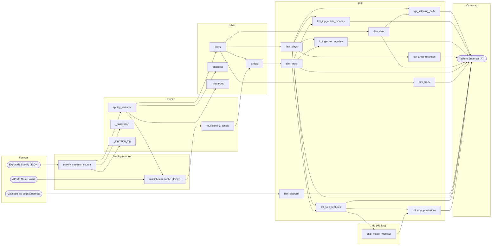

# Linaje

> Generado desde los contratos (`sources`) y `src/lakehouse/governance/lineage.py` con
> `uv run python -m lakehouse.governance docs`. No se edita a mano. En Dagster (F5) el mismo grafo
> sale de los assets.

## Tabla a tabla

## Columnas clave

| Columna destino | Viene de | Cómo |
|---|---|---|
| `bronze.spotify_streams.ip_addr_hash` | `landing.spotify_streams_source.ip_addr` | HMAC-SHA256 con la sal IP_HASH_SALT; la IP en claro no sale de landing (D8) |
| `silver.plays.(sin IP)` | `bronze.spotify_streams.ip_addr_hash` | Se elimina: ninguna tabla de Plata u Oro tiene columnas de IP |
| `silver.plays.play_id` | `bronze.spotify_streams.ts` `bronze.spotify_streams.spotify_track_uri` `bronze.spotify_streams.ms_played` | SHA-256 de la llave de deduplicacion |
| `silver.plays.ts_start` | `bronze.spotify_streams.ts` `bronze.spotify_streams.ms_played` | ts (fin) menos ms_played |
| `silver.plays.local_date / local_hour / local_weekday` | `bronze.spotify_streams.ts` `bronze.spotify_streams.conn_country` | Zona IANA del pais (o de la sesion si el pais es ZZ) aplicada al inicio |
| `silver.plays.platform_family` | `bronze.spotify_streams.platform` | Primer patron que coincide (transformation/catalogs.py) |
| `silver.plays.session_id` | `bronze.spotify_streams.ts` `bronze.spotify_streams.ms_played` | Nueva sesion tras mas de 30 min sin escuchar |
| `silver.plays.is_skip` | `bronze.spotify_streams.reason_end` `bronze.spotify_streams.ms_played` | fwdbtn/backbtn = skip; trackdone = no; endplay/playbtn segun 30 s; otro = null |
| `silver.plays.offline_at` | `bronze.spotify_streams.offline_timestamp` | Epoch en segundos o milisegundos normalizado a UTC (H-003) |
| `silver.artists.primary_genre` | `bronze.musicbrainz_artists.genres` `bronze.musicbrainz_artists.status` | Genero con mas votos, solo si hubo match confiable |
| `gold.fact_plays.date_key` | `silver.plays.local_date` | Fecha local como AAAAMMDD (dim_date) |
| `gold.fact_plays.artist_key` | `silver.plays.artist_name` | Primeros 16 hex del SHA-256 del nombre (dim_artist) |
| `gold.fact_plays.track_key` | `silver.plays.track_uri` | URI de la cancion (dim_track) |
| `gold.kpi_listening_daily.skip_rate` | `gold.fact_plays.is_skip` | skips / reproducciones etiquetadas por dia local |
| `gold.kpi_genres_monthly.genre` | `gold.dim_artist.primary_genre` `gold.fact_plays.artist_key` | Genero principal del artista de cada reproduccion |
| `gold.kpi_artist_retention.retention_rate` | `gold.fact_plays.artist_key` `gold.fact_plays.date_key` | Artistas de la cohorte escuchados N meses despues / tamano de la cohorte |
| `gold.ml_skip_features.track_prior_skip_rate` | `gold.fact_plays.is_skip` `gold.fact_plays.track_key` `gold.fact_plays.ts_start` | Skips / etiquetadas de la misma cancion que empezaron antes (sin fuga) |
| `gold.ml_skip_predictions.skip_probability` | `gold.ml_skip_features.(todas las features)` | Modelo registrado en MLflow (ml.skip_model) aplicado por lote a cada fila |
