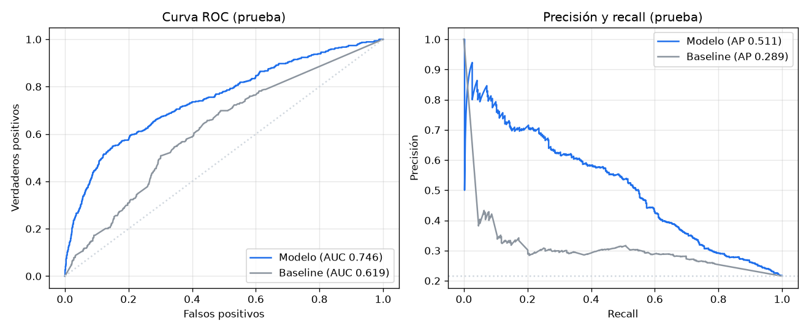
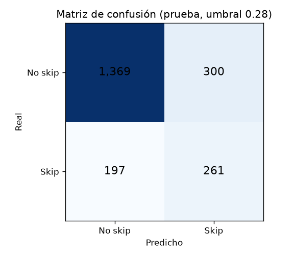
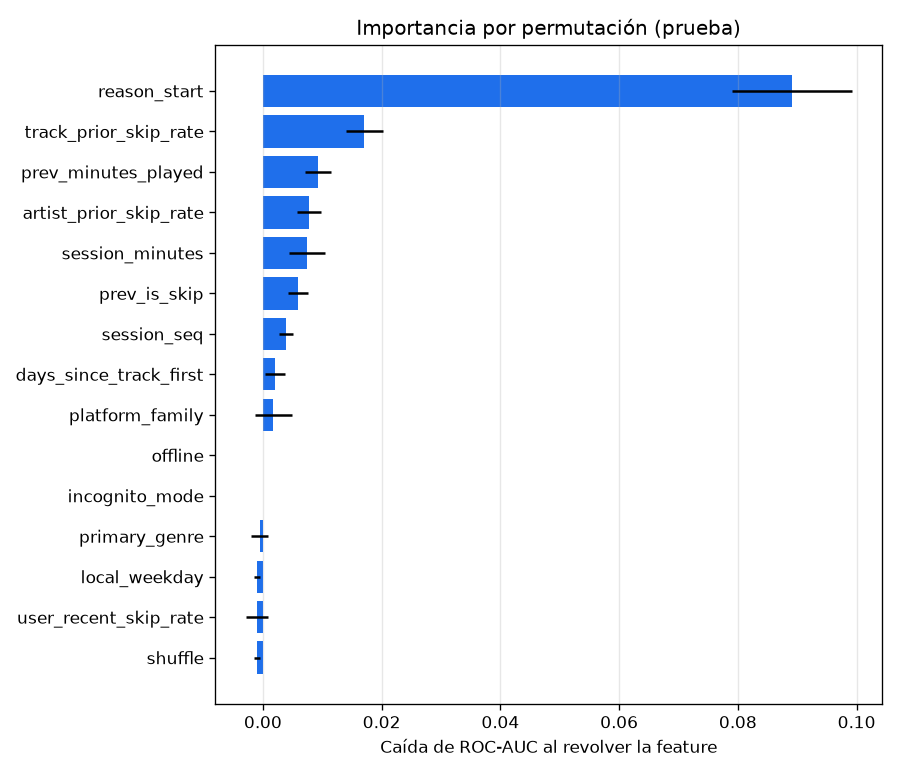

# Métricas del modelo de skip

> Generado por `python -m lakehouse.ml train` (paso `ml_train` de Dagster) el 2026-11-25 00:00 UTC. No se edita a mano. Solo números agregados: ninguna fila, canción ni artista.

## Veredicto

**El modelo le gana al baseline en el periodo de prueba:** ROC-AUC 0.746 contra 0.619 y PR-AUC 0.511 contra 0.289.

- MLflow: modelo `lakehouse_skip` versión 6, corrida `5df5f1bc` (alias `champion`: la usa la inferencia).
- Modelo: `HistGradientBoostingClassifier` (scikit-learn) con one-hot de plataforma, motivo de inicio y género. El umbral maximiza F1 en validación.
- Baseline: tasa de skip histórica de la canción. Si la canción es nueva, usa la tasa reciente del usuario y, si tampoco hay, la de entrenamiento.

## Datos y split temporal

Solo entrenan las reproducciones con etiqueta. El corte es por fecha, nunca al azar: el modelo no ve el futuro.

| Partición | Periodo (UTC) | Filas | Tasa de skip |
|---|---|---|---|
| Entrenamiento | antes del 2020-03-25 | 9,921 | 0.172 |
| Validación | 2020-03-25 al 2022-01-10 | 2,126 | 0.187 |
| Prueba | desde el 2022-01-10 | 2,127 | 0.215 |
| Sin etiqueta | (no entrena; sí recibe predicción) | 1,454 | |

## Modelo contra baseline

| Métrica | Modelo (validación) | Baseline (validación) | Modelo (prueba) | Baseline (prueba) |
|---|---|---|---|---|
| ROC-AUC | 0.792 | 0.639 | 0.746 | 0.619 |
| PR-AUC | 0.550 | 0.261 | 0.511 | 0.289 |
| F1 | 0.537 | 0.370 | 0.512 | 0.396 |
| Precisión | 0.500 | 0.269 | 0.465 | 0.289 |
| Recall | 0.579 | 0.592 | 0.570 | 0.627 |
| Exactitud | 0.813 | 0.624 | 0.766 | 0.588 |
| Umbral | 0.283 | 0.146 | 0.283 | 0.146 |

## Matriz de confusión (prueba, modelo, umbral 0.283)

| | Predicho no skip | Predicho skip |
|---|---|---|
| **Real no skip** | 1,369 | 300 |
| **Real skip** | 197 | 261 |

## Importancia de features (permutación, prueba)

Cuánto baja el ROC-AUC de prueba al revolver cada feature. Cerca de 0 = el modelo casi no la usa.

| Feature | Caída de ROC-AUC | Desviación |
|---|---|---|
| `reason_start` | 0.0891 | 0.0101 |
| `track_prior_skip_rate` | 0.0171 | 0.0031 |
| `prev_minutes_played` | 0.0092 | 0.0022 |
| `artist_prior_skip_rate` | 0.0077 | 0.0021 |
| `session_minutes` | 0.0074 | 0.0031 |
| `prev_is_skip` | 0.0059 | 0.0016 |
| `session_seq` | 0.0040 | 0.0012 |
| `days_since_track_first` | 0.0020 | 0.0017 |
| `platform_family` | 0.0018 | 0.0031 |
| `offline` | 0.0000 | 0.0000 |
| `incognito_mode` | 0.0000 | 0.0000 |
| `primary_genre` | -0.0005 | 0.0014 |
| `local_weekday` | -0.0010 | 0.0006 |
| `user_recent_skip_rate` | -0.0010 | 0.0019 |
| `shuffle` | -0.0011 | 0.0005 |
| `track_prior_plays` | -0.0012 | 0.0008 |
| `is_weekend` | -0.0014 | 0.0017 |
| `local_hour` | -0.0020 | 0.0006 |
| `artist_prior_plays` | -0.0021 | 0.0024 |

## Gráficas

## Cómo se regenera

Con el pipeline de Dagster (pasos `ml_features`, `ml_train` y `ml_predict`) o a mano dentro del contenedor: `python -m lakehouse.ml all`.
