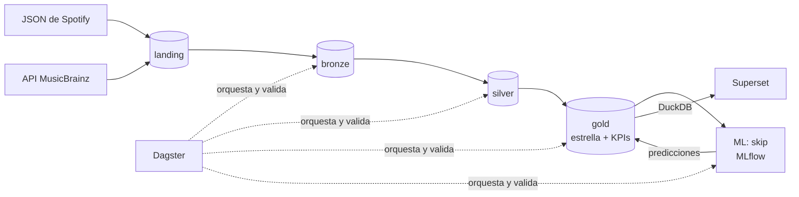

# Lakehouse Empresarial

Proyecto Final de **Datos Masivos** (Universidad Panamericana). Un Data Lakehouse local y de costo cero sobre el
historial extendido de reproducciones de Spotify de un integrante, de punta a punta:

- **Almacenamiento:** MinIO (S3 local en Docker), un bucket por capa y un usuario con permisos mínimos por servicio.
- **Formato y cómputo:** Delta Lake con Apache Spark (PySpark), arquitectura Medallion (Bronce > Plata > Oro).
- **Orquestación:** Dagster: sensores y schedules (sin ejecuciones manuales), checks de calidad que bloquean, linaje
  y monitoreo.
- **Gobernanza:** contratos de esquema, catálogo, linaje, pruebas de calidad por capa y seudonimización de la IP.
- **Machine Learning:** predicción de skips leyendo de Oro, con seguimiento y registro en MLflow.
- **BI:** tablero en Apache Superset que lee Oro directo de MinIO con DuckDB.
- **DevOps:** uv (Python 3.11), Docker Compose y CI en GitHub Actions con datos sintéticos.

> **Estado (2026-11-24):** el código de las 8 fases técnicas está completo. Falta la corrida final con los datos
> reales, las capturas del tablero y el video. Avance en [DOCS/ROADMAP.md](DOCS/ROADMAP.md). Entrega: 30 de
> noviembre de 2026.



Diagrama completo y entregables: [ENTREGABLES/](ENTREGABLES/README.md). Decisiones y su porqué:
[DOCS/ARQUITECTURA.md](DOCS/ARQUITECTURA.md).

## Estructura

| Carpeta | Contenido |
|---|---|
| [`src/lakehouse/`](src/lakehouse/) | Código del pipeline, un subpaquete por rol (`common`, `ingestion`, `transformation`, `governance`, `ml`, `orchestration`) |
| [`bi/`](bi/) | Tablero como código: SQL sobre Oro, gráficas y filtros, y su prueba en vivo |
| [`infra/`](infra/), [`docker-compose.yml`](docker-compose.yml) | Imágenes (Spark + Delta, Superset), MinIO, Dagster y la prueba de réplica |
| [`notebooks/`](notebooks/) | Notebook de presentación del modelo |
| [`tests/`](tests/) | Pruebas, espejo de `src/lakehouse/` más `bi/` |
| [`ENTREGABLES/`](ENTREGABLES/) | Entregables que no son código: diagrama, reportes, tablero, video |
| [`DOCS/`](DOCS/) | Arquitectura, decisiones, datos fuente, rúbrica, roadmap |
| [`MDS_DE_ESTUDIO/`](MDS_DE_ESTUDIO/) | Guía de cada integrante sobre su parte |

## Cómo replicar

Requisitos: [Docker Desktop](https://www.docker.com/products/docker-desktop/) (prendido, con ~8 GB de RAM),
[uv](https://docs.astral.sh/uv/) y PowerShell 7 (`pwsh`). Los datos reales no se publican (privacidad); todo corre
igual con datos sintéticos del mismo esquema.

### Opción rápida: un solo comando (datos sintéticos)

En la raíz de un clon limpio:

```powershell
pwsh -File infra/replica.ps1 -Keep
```

El script hace todo sin pasos manuales:

1. Arma el `.env` con contraseñas aleatorias.
2. Corre lint y pruebas.
3. Genera los sintéticos.
4. Levanta el stack; los sensores de Dagster corren el pipeline completo.
5. Verifica la salud, cada gráfica del tablero y las pruebas con Spark.

Termina con `REPLICA OK` y los minutos que tardó (la primera vez tarda más, porque construye las imágenes). Con `-Keep` el stack queda arriba para
explorarlo (pasos 5 a 7). Sin `-Keep`, lo borra al final.

### Paso a paso

#### 1. Infraestructura

```powershell
Copy-Item .env.example .env          # luego cambia la contraseña de MinIO en .env
# Secretos (se agregan a .env sin imprimirse): sal de IPs, 5 usuarios de MinIO y Superset.
$secrets = 'IP_HASH_SALT','MINIO_SECRET_INGESTION','MINIO_SECRET_TRANSFORMATION','MINIO_SECRET_GOVERNANCE',
           'MINIO_SECRET_ML','MINIO_SECRET_BI','SUPERSET_SECRET_KEY','SUPERSET_ADMIN_PASSWORD'
foreach ($v in $secrets) {
  $b = New-Object byte[] 24; [Security.Cryptography.RandomNumberGenerator]::Create().GetBytes($b)
  Add-Content .env ("$v=" + (-join ($b | ForEach-Object { $_.ToString('x2') }))) }
```

Sin datos reales, genera los sintéticos y apunta el `.env` a ellos (igual que CI):

```powershell
uv run python -m lakehouse.ingestion synthetic --out sinteticos --rows 5000
# en .env: SPOTIFY_DATA_DIR=./sinteticos y GENRES_SOURCE=synthetic (no consulta MusicBrainz)
```

Con el historial real, `SPOTIFY_DATA_DIR` apunta a la carpeta de los JSON. No mezcles sintéticos y reales en el
mismo MinIO; para cambiar, `docker compose down -v`.

```powershell
docker compose up -d --build         # la primera vez tarda (Java, PySpark, JARs y Superset)
docker compose exec lakehouse python -m lakehouse.common.smoke
```

El smoke termina con `Smoke OK`. Servicios:

| Servicio | Dirección | Acceso |
|---|---|---|
| MinIO (consola) | <http://localhost:9001> | Usuario y contraseña root del `.env` |
| Dagster | <http://localhost:3300> | Sin usuario |
| MLflow | <http://localhost:5000> | Sin usuario |
| Superset | <http://localhost:8088> | `admin` con `SUPERSET_ADMIN_PASSWORD` del `.env` |

#### 2. El pipeline corre solo (Dagster)

Al levantar el stack, los sensores de Dagster ven los archivos de `SPOTIFY_DATA_DIR` y corren todo sin que hagas nada:

- **Ingesta:** landing y Bronce; IP seudonimizada y registros malos a cuarentena.
- **Géneros:** desde MusicBrainz, con caché (con datos reales tarda ~1 hora solo la primera vez).
- **Plata y Oro:** limpieza, sesiones, modelo estrella, KPIs y reconciliación de conteos.
- **ML:** features, entrenamiento e inferencia.
- **Calidad y reporte:** checks después de cada paso (si uno falla, lo siguiente no corre), reporte de calidad y
  salud.

Después repite el pipeline todos los días a las 6:00 y revisa la salud cada 6 horas.

```powershell
docker compose exec lakehouse python -m lakehouse.orchestration wait     # espera a que termine
docker compose exec lakehouse python -m lakehouse.orchestration status   # corridas y checks
docker compose exec lakehouse python -m lakehouse.orchestration health   # tamaños, versiones y alertas
```

`status` debe mostrar las corridas en `SUCCESS` y `Checks: SUCCEEDED=22`.

- **En la UI:** **Lineage** muestra el grafo (sale de los contratos) y **Automation** los sensores y schedules.
- **Una corrida a la vez:** si la máquina estuvo apagada a las 6:00, al levantar el stack Dagster corre el pipeline
  que se perdió. Mientras tanto, `run` se niega a correr otro, porque dos Spark a la vez agotan la memoria (H-011).

#### 3. Cada pieza a mano (opcional)

Los mismos comandos que Dagster envuelve. Re-correr no duplica nada:

```powershell
docker compose exec lakehouse python -m lakehouse.ingestion all          # landing + Bronce
docker compose exec lakehouse python -m lakehouse.ingestion genres       # géneros (MusicBrainz)
docker compose exec lakehouse python -m lakehouse.transformation all     # Plata + Oro + reconciliación
docker compose exec lakehouse python -m lakehouse.governance check       # calidad por capa y accesos
docker compose exec lakehouse python -m lakehouse.ml all                 # features, entrenamiento, inferencia
docker compose exec lakehouse python -m lakehouse.orchestration run --job lakehouse_full  # todo por Dagster
```

#### 4. Gobernanza

[`CALIDAD_Y_LINAJE.md`](ENTREGABLES/03_calidad_y_linaje/CALIDAD_Y_LINAJE.md) se reescribe en cada corrida, solo con
conteos. El catálogo y el linaje salen de los contratos: `uv run python -m lakehouse.governance docs`.

#### 5. Machine Learning

MLflow (<http://localhost:5000>, vista **Model training**) guarda cada entrenamiento. La versión que le gana al
baseline recibe el alias `champion`, y la inferencia la usa para escribir `gold.ml_skip_predictions`.

- **Resultado:** [`ML_METRICAS.md`](ENTREGABLES/04_modelo_ml/ML_METRICAS.md).
- **Notebook:** [`notebooks/ml_skip.ipynb`](notebooks/ml_skip.ipynb). Se abre con `uv sync --group notebook` y el
  kernel del `.venv`.

#### 6. Tablero de BI

<http://localhost:8088/superset/dashboard/spotify-lakehouse/> (usuario `admin`). Trae:

- 15 gráficas: KPIs, tendencias, plataformas, top artistas y géneros, hábitos, retención y modelo contra realidad.
- 3 filtros: fecha, género y plataforma.

Se importa solo desde [`bi/`](bi/) en cada arranque. Prueba en vivo de cada gráfica, con su tiempo:

```powershell
docker compose exec superset python /opt/lakehouse/bi/check.py   # termina con "15 de 15 graficas OK"
```

#### 7. Pruebas

```powershell
uv sync                              # instala Python 3.11 y las dependencias del uv.lock
uv run ruff check .
uv run pytest                        # las de Spark se saltan en local
docker compose exec lakehouse pytest # todas, incluidas las de Spark
```

CI ([`.github/workflows/ci.yml`](.github/workflows/ci.yml)) corre en cada push:

1. Lint y pruebas.
2. MinIO con sus usuarios, MLflow y el pipeline completo por Dagster con sintéticos.
3. Las pruebas con Spark.
4. El tablero, con cada gráfica probada.

## Equipo

| Rol | Integrante | ID |
|---|---|---|
| Arquitecto de Datos / Líder | Gabriel Álvarez Mendoza | 0261445 |
| Ingeniero de Datos (Ingesta) | Ricardo Zerón del Valle | 0261606 |
| Ingeniero de Datos (Transformación) | Juan Pablo Ramirez Carlón | 0262576 |
| Oficial de Gobernanza y Seguridad | Victor Gabriel Torres Guerrero | 0265786 |
| Analista de Datos / BI | Emilio Rendón Trias | 0267019 |
| Ingeniero de ML | Fernando Peña Meade | 0261604 |
| Ingeniera DevOps / MLOps | Nora Valentina Frías Alpízar | 0268966 |

Qué parte del repo le toca a cada quien: [DOCS/EQUIPO.md](DOCS/EQUIPO.md).
